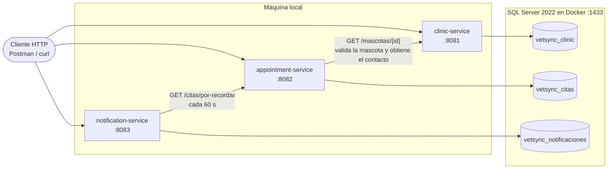

# VetSync

Sistema de gestión de citas y telemedicina veterinaria, de **uso personal y local**: se ejecuta en tu propia máquina y no se despliega en ningún servidor.

VetSync cubre exactamente tres requisitos de negocio, cada uno en su propio microservicio:

| # | Requisito | Servicio |
|---|---|---|
| 1 | Registro de propietarios y mascotas, con historial médico | `clinic-service` |
| 2 | Agendamiento de citas sin choques de horario para los veterinarios | `appointment-service` |
| 3 | Notificación simulada por correo cuando la cita está próxima | `notification-service` |

> **Sin autenticación.** La API no tiene autenticación ni autorización. Por eso cada servicio escucha solo en `127.0.0.1` y no es alcanzable desde la red.

## Contenido

- [Stack tecnológico](#stack-tecnológico)
- [Arquitectura](#arquitectura)
- [Requisitos previos](#requisitos-previos)
- [Puesta en marcha](#puesta-en-marcha)
- [Cómo ejecutar los 3 microservicios](#cómo-ejecutar-los-3-microservicios)
- [Probar el sistema](#probar-el-sistema)
- [Configuración](#configuración)
- [Pruebas automatizadas](#pruebas-automatizadas)
- [Reglas de calidad del código](#reglas-de-calidad-del-código)
- [Alcance y limitaciones](#alcance-y-limitaciones)
- [Solución de problemas](#solución-de-problemas)

## Stack tecnológico

| Pieza | Tecnología |
|---|---|
| Lenguaje | Java 21 (`release 21`) |
| Framework | Spring Boot 3.5.16 (`spring-boot-starter-web`, `spring-boot-starter-data-jpa`) |
| Build | Maven multi-módulo, con Maven Wrapper (`mvnw` / `mvnw.cmd`, Maven 3.9.16) |
| Base de datos | SQL Server 2022 en Docker, **una base por servicio** (driver `mssql-jdbc`) |
| Migraciones | Flyway (`flyway-core` + `flyway-sqlserver`) |
| Cliente HTTP entre servicios | `RestClient` de Spring, con timeouts de conexión (2 s) y lectura (5 s) |
| Errores HTTP | `ProblemDetail` (RFC 7807) |
| Pruebas | JUnit 5, AssertJ, Spring Boot Test (`@WebMvcTest`), Testcontainers (SQL Server real), ArchUnit 1.4.1 |
| Estilo | Checkstyle 10.26.1 (el build falla si no se cumple) |
| Compilador | `-Xlint:rawtypes -Xlint:unchecked -Werror` |

No se usan Lombok ni bases de datos en memoria (H2/HSQLDB). No hay API gateway, broker de mensajes, caché, frontend ni módulo `common` compartido.

## Arquitectura

Tres microservicios autónomos. Cada uno tiene su base de datos y sus migraciones; la comunicación es REST síncrona y **en un solo sentido**.



| Servicio | Puerto | Base de datos | Responsabilidad |
|---|---|---|---|
| `clinic-service` | 8081 | `vetsync_clinic` | Propietarios, mascotas e historial médico |
| `appointment-service` | 8082 | `vetsync_citas` | Veterinarios y agenda de citas sin choques |
| `notification-service` | 8083 | `vetsync_notificaciones` | Recordatorios de cita por correo simulado |

Reglas que se mantienen en todo el sistema:

- Un servicio solo accede a **su** base de datos. No hay joins ni claves foráneas entre bases: se referencian por ID (`mascota_id`, `veterinario_id`, `cita_id`).
- No se comparte código entre servicios; un DTO pequeño se duplica antes que acoplar.
- La hora sale de un `java.time.Clock` inyectado. Todas las fechas son **hora local de la clínica**, sin zona (`DATETIME2`).

### Estructura de cada servicio

Arquitectura hexagonal, paquete base `com.vetsync.<servicio>`:

```
domain/                  entidades, value objects, enums y excepciones de dominio (Java puro)
application/
  port/in/               interfaces de casos de uso            (AgendarCitaUseCase)
  port/out/              interfaces de salida                  (CitaRepository, ClinicaGateway, CorreoSender)
  service/               implementaciones de los casos de uso  (AgendarCitaService)
infrastructure/
  web/                   controllers, DTOs REST, @RestControllerAdvice
  persistence/           entidades JPA, repositorios Spring Data, adapters
  client/ mail/ scheduler/   adapters hacia otros servicios, correo simulado, tareas programadas
  config/                @Configuration, @ConfigurationProperties, Clock
```

La dependencia siempre va `infrastructure → application → domain`. Lo verifica ArchUnit en cada build.

### Garantías clave

- **Sin choques de horario.** Se validan en el caso de uso y también en la base: el índice único filtrado `UX_cita_veterinario_inicio` impide dos citas `PROGRAMADA` de un veterinario en el mismo inicio. Cancelar una cita libera la franja.
- **Franjas de 30 minutos** alineadas a la media hora (`:00` o `:30`), dentro del horario de atención (por defecto 08:00–18:00, así que la última cita empieza a las 17:30).
- **Un solo recordatorio por cita.** La restricción única `UQ_notificacion_cita_tipo (cita_id, tipo)` lo garantiza aunque se reintente la revisión.

## Requisitos previos

| Herramienta | Versión | Para qué |
|---|---|---|
| JDK | 21 o superior | Compilar y ejecutar los servicios |
| Docker (Docker Desktop en Windows) | Reciente, con `docker compose` v2 | SQL Server y pruebas de integración |
| Git Bash o PowerShell | — | Ejecutar los comandos |

**No necesitas instalar Maven**: el repositorio incluye el wrapper. Usa `./mvnw` en Git Bash/Linux/macOS o `.\mvnw.cmd` en PowerShell. La primera ejecución descarga Maven, así que necesita conexión a internet.

## Puesta en marcha

### 1. Configura la contraseña de la base de datos

Copia la plantilla y define tu propia contraseña de SQL Server. El archivo `.env` está en `.gitignore`; **nunca** se versiona.

```bash
cp .env.example .env
```

```powershell
Copy-Item .env.example .env
```

Edita `.env` y cambia `DB_PASSWORD` por una contraseña tuya. SQL Server exige una contraseña de al menos 8 caracteres con mayúscula, minúscula, número y símbolo. Variables de `.env`:

| Variable | Valor por defecto | Descripción |
|---|---|---|
| `DB_PASSWORD` | — (obligatoria) | Contraseña del usuario `sa` de SQL Server |
| `DB_PORT` | `1433` | Puerto de SQL Server en tu máquina |

### 2. Levanta SQL Server y crea las bases

```bash
docker compose up -d
```

Esto arranca el contenedor `vetsync-sqlserver` (SQL Server 2022, publicado solo en `127.0.0.1`) y ejecuta una tarea de una sola vez, `db-init`, que crea las tres bases (`vetsync_clinic`, `vetsync_citas`, `vetsync_notificaciones`) si no existen. El esquema lo crea Flyway al arrancar cada servicio.

Comprueba que la base está sana y que `db-init` terminó con éxito antes de seguir:

```bash
docker compose ps -a
```

`vetsync-sqlserver` debe figurar como `healthy` y `db-init` como `Exited (0)`.

## Cómo ejecutar los 3 microservicios

Cada servicio corre en **su propia terminal** desde la raíz del repositorio. El orden recomendado es `clinic` → `appointment` → `notification`, porque cada uno consulta al anterior.

**Terminal 1 — `clinic-service` (puerto 8081)**

```powershell
.\mvnw.cmd -pl clinic-service spring-boot:run
```

```bash
./mvnw -pl clinic-service spring-boot:run
```

**Terminal 2 — `appointment-service` (puerto 8082)**

```powershell
.\mvnw.cmd -pl appointment-service spring-boot:run
```

```bash
./mvnw -pl appointment-service spring-boot:run
```

**Terminal 3 — `notification-service` (puerto 8083)**

```powershell
.\mvnw.cmd -pl notification-service spring-boot:run
```

```bash
./mvnw -pl notification-service spring-boot:run
```

Cada comando muestra una línea como `Started ClinicServiceApplication in … seconds` cuando el servicio está listo. Para detener un servicio, pulsa `Ctrl+C` en su terminal.

Comprobación rápida de que los tres responden (un `404` o un `200` indican que el servicio está vivo; un error de conexión indica que no arrancó):

```bash
curl -i http://127.0.0.1:8081/mascotas/1
curl -i http://127.0.0.1:8082/veterinarios
curl -i http://127.0.0.1:8083/notificaciones
```

Cómo se leen la configuración y los secretos:

- Cada servicio ejecutado con `spring-boot:run` arranca con su carpeta de módulo como directorio de trabajo y lee `../.env` (el de la raíz). No hace falta exportar variables a mano.
- Los servicios dependen entre sí solo en tiempo de petición: `appointment-service` llama a `clinic-service` al agendar, y `notification-service` llama a `appointment-service` en cada revisión. Si el servicio consultado no está disponible, la respuesta es un `503` (o, en `notification-service`, se registra el error y se reintenta en la siguiente revisión).

## Probar el sistema

La referencia completa de endpoints, validaciones y errores está en **[docs/API.md](docs/API.md)**, junto con la lista de peticiones de prueba, paso a paso, con los códigos de respuesta esperados.

Flujo mínimo de punta a punta (el `1` de cada URL es el `id` que devuelve el paso anterior):

1. `POST http://127.0.0.1:8081/propietarios` — registra a un propietario.
2. `POST http://127.0.0.1:8081/propietarios/1/mascotas` — registra su mascota.
3. `POST http://127.0.0.1:8082/veterinarios` — registra un veterinario.
4. `POST http://127.0.0.1:8082/citas` — agenda una cita para hoy o mañana (futura, en `:00` o `:30`, entre 08:00 y 17:30).
5. Espera hasta 60 segundos y consulta `GET http://127.0.0.1:8083/notificaciones` — aparece el recordatorio. El "correo" también queda escrito en el log de `notification-service`.

Ejemplo de la primera petición con `curl` (Git Bash, Linux o macOS):

```bash
curl -i -X POST http://127.0.0.1:8081/propietarios \
  -H "Content-Type: application/json" \
  -d '{"nombre": "Ana Perez", "correo": "ana@correo.com", "telefono": "555-1234"}'
```

En PowerShell, con `Invoke-RestMethod`:

```powershell
Invoke-RestMethod -Method Post -Uri http://127.0.0.1:8081/propietarios `
  -ContentType "application/json" `
  -Body '{"nombre": "Ana Perez", "correo": "ana@correo.com", "telefono": "555-1234"}'
```

Para pruebas más cómodas, importa las peticiones de `docs/API.md` en Postman, Insomnia o el cliente HTTP de tu IDE.

## Configuración

Los tres servicios usan la misma convención: valores por defecto en `src/main/resources/application.yml` de cada módulo, y variables de entorno o `.env` para lo que cambia entre máquinas. **Las contraseñas nunca van en el código ni en los YAML.**

| Variable | Servicios | Por defecto | Descripción |
|---|---|---|---|
| `DB_PASSWORD` | los 3 | — (obligatoria) | Contraseña de la base de datos |
| `DB_USER` | los 3 | `sa` | Usuario de la base de datos |
| `DB_HOST` | los 3 | `localhost` | Host de SQL Server |
| `DB_PORT` | los 3 | `1433` | Puerto de SQL Server |
| `CLINIC_SERVICE_URL` | `appointment-service` | `http://localhost:8081` | URL base de `clinic-service` |
| `APPOINTMENT_SERVICE_URL` | `notification-service` | `http://localhost:8082` | URL base de `appointment-service` |

Parámetros de negocio en `application.yml`:

| Propiedad | Servicio | Por defecto | Descripción |
|---|---|---|---|
| `vetsync.agenda.hora-apertura` | `appointment-service` | `8` | Hora de apertura (0–24) |
| `vetsync.agenda.hora-cierre` | `appointment-service` | `18` | Hora de cierre (0–24). La franja de 30 min debe terminar a más tardar a esta hora |
| `vetsync.recordatorio.anticipacion-horas` | `notification-service` | `24` | Se avisa cuando faltan esas horas o menos para la cita. Máximo `168` (7 días) |
| `vetsync.recordatorio.intervalo` | `notification-service` | `60s` | Cada cuánto se revisan las citas próximas. La primera revisión ocurre tras un intervalo completo desde el arranque |

Para ver un recordatorio sin esperar a que una cita esté a menos de 24 horas, puedes subir `anticipacion-horas` (hasta 168) y bajar `intervalo` (por ejemplo `10s`) en el `application.yml` de `notification-service`, y reiniciarlo.

## Pruebas automatizadas

| Comando | Qué ejecuta | ¿Necesita Docker? |
|---|---|---|
| `./mvnw test` | Checkstyle + pruebas unitarias + ArchUnit | **No** |
| `./mvnw verify` | Lo anterior + pruebas de integración `*IT` con Testcontainers (SQL Server real) | **Sí** |

En PowerShell usa `.\mvnw.cmd` en lugar de `./mvnw`. Una tarea se considera terminada cuando `verify` pasa en verde.

Tipos de prueba:

- **Dominio y aplicación:** unitarias sin Spring, con fakes en memoria que implementan las mismas interfaces que los adapters reales (`InMemoryCitaRepository`, `FakeClinicaGateway`).
- **Controllers:** `@WebMvcTest`.
- **Adapters y base de datos:** `*IT` con Testcontainers y SQL Server 2022 real (los índices filtrados del esquema no existen en bases en memoria).
- **Arquitectura:** `ArquitecturaTest` (ArchUnit) en cada servicio.
- **Punta a punta:** `ClinicaEndToEndIT`, `CitasEndToEndIT` y `NotificacionesEndToEndIT`.

## Reglas de calidad del código

Las reglas obligatorias del repositorio están en [AGENTS.md](AGENTS.md). Las marcadas como automáticas las verifica `mvn verify`; si el build falla por ellas, se corrige el código, no la configuración de Checkstyle ni las pruebas de arquitectura. Resumen:

- Nombrado en `camelCase` (constantes en `UPPER_SNAKE_CASE`); dominio en español, términos técnicos y capas en inglés.
- Todo colaborador con comportamiento tiene interfaz; inyección por constructor.
- Acceso a BD, HTTP y correo dentro de un `try/catch` en su `Adapter`, con excepción específica y causa conservada. Prohibido `catch (Exception)`.
- Prohibido `Object`, tipos crudos y casts sin comprobar.
- TDD: primero la prueba que falla.
- El esquema solo cambia con migraciones Flyway nuevas (`V{n}__descripcion.sql`); `ddl-auto` es siempre `validate`.

## Alcance y limitaciones

Lo siguiente es deliberado o aún no está implementado. Conviene tenerlo presente al probar:

- **Telemedicina parcial.** La tabla `cita` tiene las columnas `modalidad` (`PRESENCIAL` por defecto) y `enlace_videollamada`, pero la API **todavía no las acepta ni las devuelve**: si las envías en `POST /citas`, se ignoran. Toda cita se guarda hoy como `PRESENCIAL`.
- **Sin cancelación ni consulta de citas.** No hay endpoints para cancelar una cita ni para listar la agenda de un veterinario. El único listado de citas es `GET /citas/por-recordar`, de uso interno entre servicios.
- **Sin listados de propietarios ni de mascotas por propietario.** Solo se consulta una mascota por su id y su historial.
- **Veterinario del historial sin validar.** `veterinarioId` en el historial médico es una referencia lógica a `appointment-service`; `clinic-service` no la valida porque no consulta a ese servicio.
- **Correo simulado.** No se envía ningún correo real: el mensaje se escribe en el log de `notification-service` y se guarda una fila en la tabla `notificacion`.
- **Sin autenticación.** Ver el aviso al inicio.
- **Una instancia de SQL Server, tres bases.** La separación es lógica; el aislamiento por servicio es por convención y por configuración de cada `datasource`.

## Solución de problemas

| Síntoma | Causa probable | Solución |
|---|---|---|
| `docker compose up` falla con "Copia .env.example a .env y define DB_PASSWORD" | No existe `.env` o falta `DB_PASSWORD` | Crea `.env` desde `.env.example` (paso 1) |
| El contenedor de SQL Server se reinicia o `db-init` falla | La contraseña no cumple la política de SQL Server | Usa 8+ caracteres con mayúscula, minúscula, número y símbolo |
| El servicio no arranca: `Cannot open database "vetsync_…"` | `db-init` aún no terminó o no corrió | Revisa `docker compose ps -a` y `docker compose logs db-init`; repite `docker compose up -d` |
| El servicio no arranca: `Login failed for user 'sa'` | `DB_PASSWORD` de `.env` distinta de la usada al crear el volumen | Corrige `.env`, o recrea la base con `docker compose down -v` (**borra todos los datos**) |
| El servicio no arranca: `Port 808x was already in use` | Otro proceso usa el puerto | Cierra el proceso o la terminal anterior del mismo servicio |
| `Connection refused` a `1433` | SQL Server no está arriba o `DB_PORT` es otro | `docker compose ps`; confirma `DB_PORT` en `.env` |
| `POST /citas` responde `503` | `clinic-service` caído, lento (timeout de 5 s) o con una respuesta de error | Arranca `clinic-service` y reintenta |
| No aparecen recordatorios | La cita está a más de 24 h, o no pasó aún el primer intervalo (60 s) | Agenda para hoy/mañana, espera 60 s, o ajusta la configuración de recordatorios |
| `./mvnw verify` falla en los `*IT` | Docker no está en marcha | Inicia Docker Desktop; `./mvnw test` funciona sin Docker |
